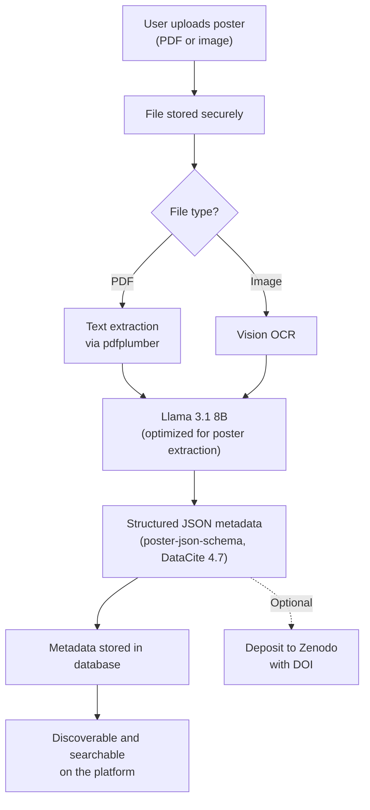

<div align="center">


<br />

<h1>Posters.science</h1>

<p>
A free, open-source platform for sharing, discovering, and citing scientific posters.
</p>

<br />

<p>
  <a href="https://github.com/fairdataihub/posters-science/graphs/contributors">
    
  </a>
  <a href="https://github.com/fairdataihub/posters-science/stargazers">
    
  </a>
  <a href="https://github.com/fairdataihub/posters-science/issues/">
    
  </a>
  <a href="https://github.com/fairdataihub/posters-science/blob/main/LICENSE">
    
  </a>
</p>

<h4>
    <a href="https://posters.science">Website</a>
  <span> · </span>
    <a href="https://docs.posters.science">User Docs</a>
  <span> · </span>
    <a href="https://dev.posters.science">Developer Docs</a>
  <span> · </span>
    <a href="https://github.com/fairdataihub/posters-science/issues/">Report Bug</a>
  <span> · </span>
    <a href="https://github.com/fairdataihub/posters-science/issues/">Request Feature</a>
</h4>
</div>

<br />

---

## About

Posters.science is a platform for researchers to upload, share, and discover scientific conference posters. When a poster is uploaded, the platform automatically extracts structured metadata such as titles, authors, affiliations, sections, and figure captions. This makes posters findable, citable, and machine-readable.

The platform is built around [FAIR principles](https://www.go-fair.org/fair-principles/) (Findable, Accessible, Interoperable, Reusable) and integrates with [Zenodo](https://zenodo.org/) so that posters can be deposited with a DOI for long-term archival and citation.

Posters.science is developed by the [FAIR Data Innovations Hub](https://fairdataihub.org/) at the [California Medical Innovations Institute (CalMI2)](https://calmi2.org/).

## Related Resources

| Resource                                                                                           | Description                                                                                                 |
| -------------------------------------------------------------------------------------------------- | ----------------------------------------------------------------------------------------------------------- |
| [poster2json](https://github.com/fairdataihub/poster2json)                                         | Python package and CLI for poster metadata extraction ([docs](https://fairdataihub.github.io/poster2json/)) |
| [poster-json-schema](https://github.com/fairdataihub/poster-json-schema)                           | JSON schema for machine-actionable and FAIR poster metadata (DataCite 4.7)                                  |
| [poster-json-examples](https://github.com/fairdataihub/poster-json-examples)                       | Manually annotated ground-truth poster examples                                                             |
| [posters-science-extraction-api](https://github.com/fairdataihub/posters-science-extraction-api)   | Extraction API service used by the platform                                                                 |
| [poster-sentry](https://github.com/fairdataihub/poster-sentry)                                     | Lightweight multimodal scientific poster classifier                                                         |
| [poster-sentry-training](https://github.com/fairdataihub/poster-sentry-training)                   | Training data and scripts for the poster-sentry classifier                                                  |
| [posters-science-user-docs](https://docs.posters.science)                                          | User documentation site                                                                                     |
| [posters-science-dev-docs](https://github.com/fairdataihub/posters-science-dev-docs)               | Developer documentation site ([live](https://dev.posters.science))                                          |
| [posters-science-survey](https://github.com/fairdataihub/posters-science-survey)                   | Community survey on scientific poster sharing practices                                                     |
| [poster-sharing-reuse-paper-code](https://github.com/fairdataihub/poster-sharing-reuse-paper-code) | Analysis code for the poster sharing and reuse study                                                        |

## Developers

### How Poster Processing Works

When a user uploads a poster (PDF or image), the platform runs an automated extraction pipeline to convert the poster into structured, machine-readable metadata. Here is what happens:



**Text extraction.** PDF posters are processed by [pdfplumber](https://github.com/jsvine/pdfplumber) for layout-aware text extraction. Image posters (JPG, PNG) are processed by a vision-language model that reads text directly from the image. This is handled by the [extraction API](https://github.com/fairdataihub/posters-science-extraction-api).

**Metadata structuring.** The extracted raw text is structured into JSON by [Llama 3.1 8B](https://huggingface.co/fairdataihub/Llama-3.1-8B-Poster-Extraction) with parameters optimized for poster extraction. The output includes titles, authors, affiliations, content sections, and figure/table captions. See [poster2json](https://github.com/fairdataihub/poster2json) for the full extraction package.

**What gets stored.** The poster file is stored securely. Extracted metadata conforming to the [poster-json-schema](https://github.com/fairdataihub/poster-json-schema) (aligned with DataCite 4.7) is stored in a PostgreSQL database and made searchable on the platform. Users can optionally deposit their poster to [Zenodo](https://zenodo.org/) for a persistent DOI.

### Tech Stack

| Layer                  | Technology                                                                                             |
| ---------------------- | ------------------------------------------------------------------------------------------------------ |
| Frontend               | [Nuxt 3](https://nuxt.com/), [Nuxt UI](https://ui.nuxt.com/), [Tailwind CSS](https://tailwindcss.com/) |
| Backend                | Nuxt server routes ([Nitro](https://nitro.build/))                                                     |
| Database               | [PostgreSQL](https://www.postgresql.org/) via [Prisma](https://www.prisma.io/)                         |
| Poster Extraction      | [poster2json](https://github.com/fairdataihub/poster2json) (Python, Llama 3.1, pdfplumber)             |
| File Storage           | CDN-backed object storage                                                                              |
| Repository Integration | [Zenodo](https://zenodo.org/)                                                                          |
| Deployment             | [Docker](https://www.docker.com/)                                                                      |

### Getting Started

#### Prerequisites

- [Node.js](https://nodejs.org/) (22.x recommended)
- [Yarn](https://yarnpkg.com/) (1.x)
- [Docker](https://www.docker.com/)
- [Volta](https://volta.sh/) (optional, for Node version management)

#### Setup

1. Clone the repository

   ```bash
   git clone https://github.com/fairdataihub/posters-science.git
   cd posters-science
   ```

2. Trust and install the required tool versions

   ```bash
   mise trust
   mise install
   ```

3. Install dependencies

   ```bash
   pnpm install
   ```

4. Add your environment variables

   ```bash
   cp .env.example .env
   ```

5. Start the development server

   ```bash
   pnpm dev
   ```

6. Open the application at [http://localhost:3000](http://localhost:3000)

   To test Sign in with ORCID or Sign in with Figshare, start the server with `pnpm dev:https` instead and open [https://127.0.0.1:3000](https://127.0.0.1:3000). See [Sign-in over https](#sign-in-over-https).

## Development

### Database

The application uses PostgreSQL. Run it locally with Docker:

```bash
docker-compose -f ./dev-docker-compose.yaml up -d
```

Stop the database:

```bash
docker-compose -f ./dev-docker-compose.yaml down
```

### Sign-in over https

ORCID and Figshare only send people back to the exact `https` address registered with them. `pnpm dev` serves `http://localhost:3000`, so their sign-in can't come back to it. To test either one:

1. Stop any running dev server, then start it over https on `127.0.0.1`:

   ```bash
   pnpm dev:https
   ```

   This runs `nuxt dev --https --host 127.0.0.1`, which makes a self-signed certificate.

2. Open [https://127.0.0.1:3000](https://127.0.0.1:3000), not `localhost`. The browser warns about the certificate once; choose Advanced, then Continue.

The rest of the app works the same with either command, so plain `pnpm dev` is fine when you aren't testing these sign-ins.

| Problem                                          | Fix                                                                                                                         |
| ------------------------------------------------ | --------------------------------------------------------------------------------------------------------------------------- |
| Back on the site but not signed in               | You started from `localhost`. The sign-in cookie belongs to the address you opened, so start from `https://127.0.0.1:3000`. |
| The dev server started on a port other than 3000 | Free port 3000, or register a second redirect address with that port and update `.env` to match.                            |

### ORCID sign-in

Local development signs in through the [ORCID sandbox](https://sandbox.orcid.org), a test copy of ORCID with no real records. The sandbox only sends email to `@mailinator.com` addresses, so test accounts use [Mailinator](https://www.mailinator.com) inboxes.

#### One-time setup

1. **Create a sandbox ORCID account.** Register at [sandbox.orcid.org/register](https://sandbox.orcid.org/register) with any `@mailinator.com` address, for example `yourname-posters@mailinator.com`.
2. **Verify the email.** Open [mailinator.com](https://www.mailinator.com), type the part before the `@` into the inbox search and open ORCID's email. No Mailinator account is needed.
   - Mailinator inboxes are public. Use a password you don't use anywhere else.
3. **Register a sandbox app.** In the sandbox, open [Developer Tools](https://sandbox.orcid.org/developer-tools) (it needs the verified email) and add this redirect URI exactly:

   ```text
   https://127.0.0.1:3000/api/auth/orcid
   ```

4. **Add the credentials to `.env`.** The ORCID buttons stay hidden until all four are set.

   ```bash
   NUXT_ORCID_ENDPOINT=https://sandbox.orcid.org
   NUXT_ORCID_CLIENT_ID=APP-XXXXXXXXXXXXXXXX
   NUXT_ORCID_CLIENT_SECRET=your-sandbox-client-secret
   NUXT_ORCID_REDIRECT_URI=https://127.0.0.1:3000/api/auth/orcid
   ```

#### Each time you test

1. Start the server with `pnpm dev:https` and open [https://127.0.0.1:3000](https://127.0.0.1:3000) (see [Sign-in over https](#sign-in-over-https)).
2. Try a flow:

   | Flow              | Where                                                                            |
   | ----------------- | -------------------------------------------------------------------------------- |
   | Sign up           | `/signup`, **Sign up with ORCID**                                                |
   | Sign in           | `/login`, **Sign in with ORCID**                                                 |
   | Link ORCID        | Settings (`/profile`), **Verify with ORCID** in the ORCID section                |
   | Another test user | Sign out of the sandbox, then register again with a different Mailinator address |

With `NUXT_SITE_ENV=development`, new ORCID accounts skip email verification on Posters.science, so you don't need to open a Mailinator inbox to finish signing up.

#### Troubleshooting

| Problem                                   | Fix                                                                                                                                                  |
| ----------------------------------------- | ---------------------------------------------------------------------------------------------------------------------------------------------------- |
| ORCID says the redirect URI doesn't match | The URI registered in Developer Tools, `NUXT_ORCID_REDIRECT_URI` and the address in your browser must match exactly, including `https` and the port. |
| No ORCID button                           | One of the four `NUXT_ORCID_*` values is empty. Restart the dev server after editing `.env`.                                                         |
| No email from the sandbox                 | The sandbox only emails `@mailinator.com` addresses.                                                                                                 |

See also the [Sign-in over https](#sign-in-over-https) table.

### Figshare publishing

Figshare has no public sandbox, so local testing uses real [figshare.com](https://figshare.com) accounts. Outside production (`NUXT_SITE_ENV` is not `production`), publishing stops at a **private draft**: the item is created on Figshare with its metadata and files, but never published. Only you can see the draft, and you can delete it from My data on Figshare. Published items can't be deleted, so keep `NUXT_FIGSHARE_ALLOW_PUBLISH=false`.

People connect their Figshare account in one of two ways:

| Way                   | Needs                                                                                                  |
| --------------------- | ------------------------------------------------------------------------------------------------------ |
| Personal token        | Works with `pnpm dev` or `pnpm dev:https`. Posters.science deletes the token an hour after it's added. |
| Sign in with Figshare | A Figshare application in `.env`, and `pnpm dev:https`                                                 |

#### One-time setup

1. **Check the encryption key.** Figshare tokens are stored encrypted with `NUXT_FIGSHARE_TOKEN_ENCRYPTION_KEY`, or with `NUXT_ZENODO_TOKEN_ENCRYPTION_KEY` when that one is empty. At least one must be set; `.env.example` shows how to make one.
2. **For Sign in with Figshare, register an application** at [figshare.com/account/applications](https://figshare.com/account/applications) with this callback URL exactly:

   ```text
   https://127.0.0.1:3000/api/figshare/callback
   ```

   An application takes only one callback URL. Every local copy uses this same address, so developers can share one dev application, while staging and production each have their own.

3. **Add the application to `.env`.** The Sign in with Figshare tab stays hidden until all three are set.

   ```bash
   NUXT_FIGSHARE_CLIENT_ID=your-client-id
   NUXT_FIGSHARE_CLIENT_SECRET=your-client-secret
   NUXT_FIGSHARE_REDIRECT_URI=https://127.0.0.1:3000/api/figshare/callback
   ```

#### Each time you test

1. For Sign in with Figshare, start the server with `pnpm dev:https` and open [https://127.0.0.1:3000](https://127.0.0.1:3000) (see [Sign-in over https](#sign-in-over-https)).
2. Upload a poster and finish Review Metadata, then choose **Figshare** on the Submit Poster page.
3. Connect with a personal token or **Sign in with Figshare**, pick categories and a license, then click **Create private draft on Figshare**.
4. Open the draft from the link at the end to check its metadata, then delete it on Figshare.

#### Troubleshooting

| Problem                                                  | Fix                                                                                                                                       |
| -------------------------------------------------------- | ----------------------------------------------------------------------------------------------------------------------------------------- |
| Figshare says `invalid_request` about the `redirect_uri` | `NUXT_FIGSHARE_REDIRECT_URI` must match the application's callback URL exactly. `localhost` and `127.0.0.1` count as different addresses. |
| No Sign in with Figshare tab                             | One of the three `NUXT_FIGSHARE_*` application values is empty. Restart the dev server after editing `.env`.                              |
| "Figshare publishing isn't available right now"          | Neither token encryption key is set.                                                                                                      |
| A personal token stopped working                         | Personal tokens are deleted an hour after they're added. Connect again.                                                                   |
| A maintenance notice instead of the Figshare form        | Figshare publication is paused in `/admin` under Maintenance.                                                                             |

### Prisma

The application uses [Prisma](https://www.prisma.io/) to interact with the database.

### UI

The application uses [Nuxt UI](https://ui.nuxt.com/) for components and [Tailwind CSS](https://tailwindcss.com/) for styling.

For user guides, see the [User Documentation](https://docs.posters.science). For architecture details, see the [Developer Documentation](https://dev.posters.science).

## Citation

```bibtex
@software{posters_science2026,
  title = {Posters.science: A Platform for Sharing, Discovering, and Citing Scientific Posters},
  author = {Soundarajan, Sanjay and O'Neill, James and Portillo, Dorian and Patel, Bhavesh},
  year = {2026},
  url = {https://github.com/fairdataihub/posters-science}
}
```

## Funding

This project is funded by [The Navigation Fund](https://www.navigation.org/) ([10.71707/rk36-9x79](https://doi.org/10.71707/rk36-9x79)).

## License

Distributed under the MIT License. See [LICENSE](LICENSE) for details.

## Contributing

Contributions are welcome! Please see [CONTRIBUTING.md](CONTRIBUTING.md) for guidelines.
